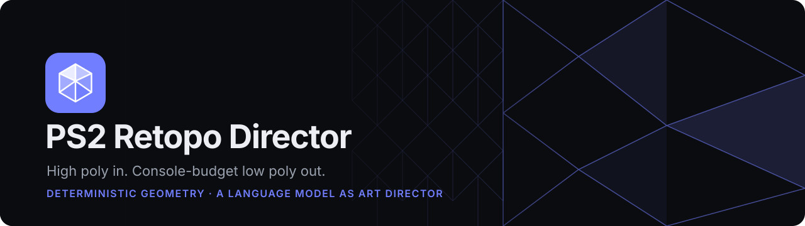
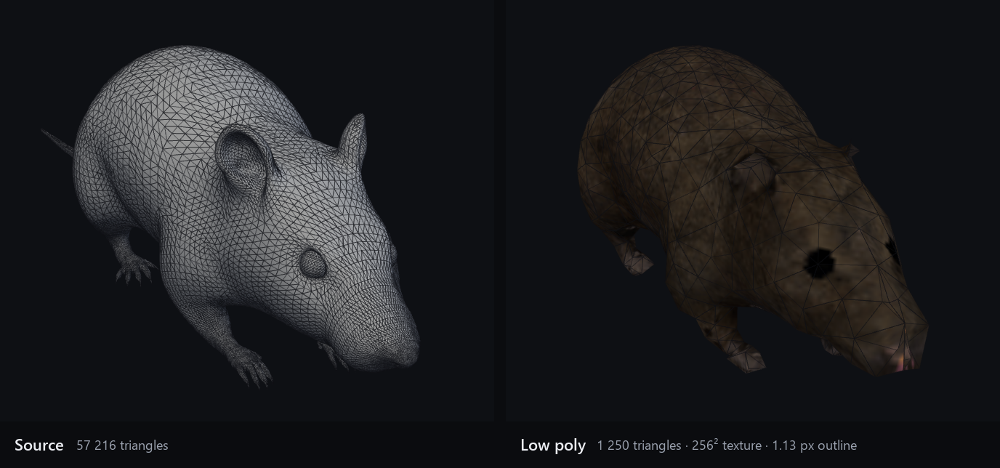
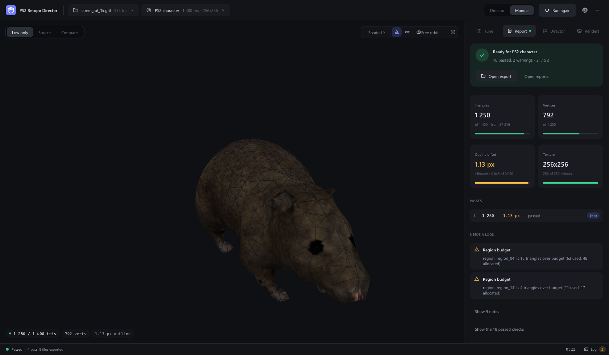
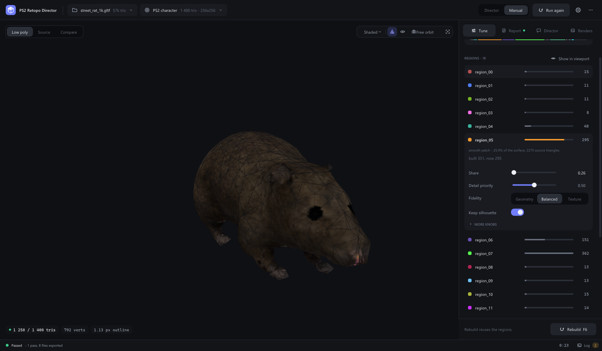
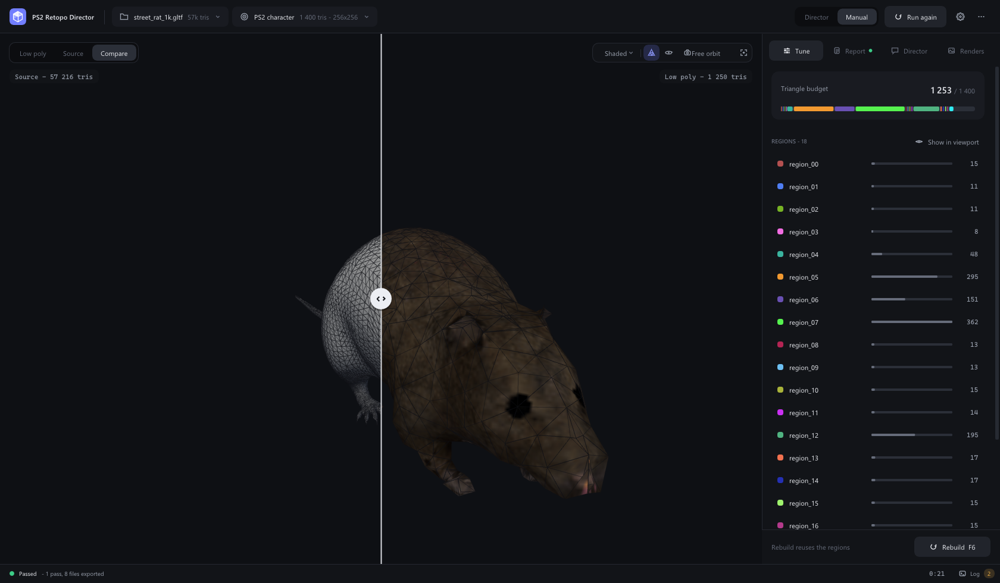
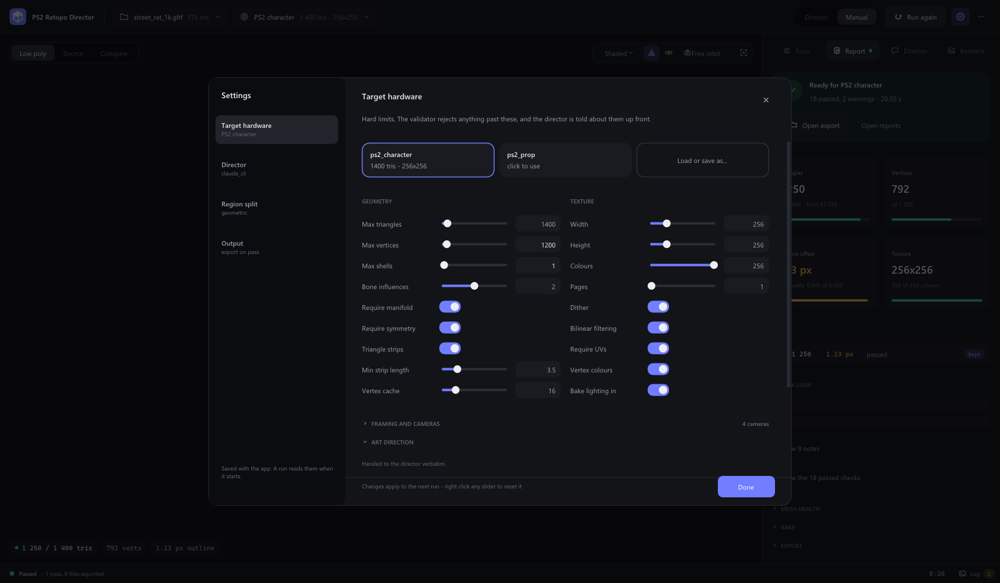
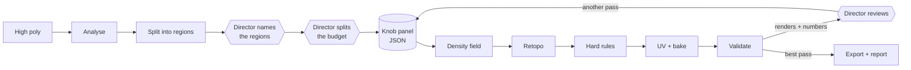

<p align="center">
  
</p>

<p align="center">
  <a href="https://github.com/doctorspider42/retopo-director/actions/workflows/ci.yml"></a>
  <a href="https://github.com/doctorspider42/retopo-director/releases/latest"></a>
  
  
  <a href="LICENSE"></a>
</p>

<p align="center">
  <b>Turns a 5  triangle sculpt into a   triangle, 256² palettised, triangle stripped PS2 asset.</b><br>
  Deterministic code does every vertex, UV and texel. A language model only directs.
</p>

<p align="center">
  <a href="#download">Download</a> ·
  <a href="#quick-start">Quick start</a> ·
  <a href="#how-it-works">How it works</a> ·
  <a href="#results">Results</a> ·
  <a href="#command-line">Command line</a> ·
  <a href="#building-from-source">Build</a>
</p>

<p align="center">
  
</p>

---

## Contents

- [What it does](#what-it-does)
- [Download](#download)
- [Quick start](#quick-start)
- [The app](#the-app)
- [How it works](#how-it-works)
- [Results](#results)
- [Command line](#command-line)
- [Director backends](#director-backends)
- [Region split: geometric or SAM](#region-split-geometric-or-sam)
- [Target profiles](#target-profiles)
- [Building from source](#building-from-source)
- [Documentation](#documentation) · [Third party](#third-party) · [Licence](#licence)

## What it does

- **Retopology to a hard budget.** A quad-dominant field or a guarded quadric collapse, chosen by topology, re-fitted until the triangle and vertex limits hold.
- **UVs that do not fold.** Charts are cut by part and flattened with Tutte plus ARAP, then packed per texture page.
- **A bake made for the hardware.** Diffuse, ambient occlusion and lighting baked into a palettised texture (4 or 8 bit CLUT), dithered if you ask for it.
- **Export that a VU1 can eat.** Vertex cache optimised, stripped, validated against the profile before a single file is written.
- **An art director, optionally.** A language model names the parts, splits the budget between them, and judges each pass from renders. It can object to the brief, but a human applies the change.
- **Proof, not vibes.** Every pass is measured: silhouette error per camera, outline offset in pixels, every hard check with the number that decided it.

## Download

Every green push to `main` is published as a release: **[Releases → latest](https://github.com/doctorspider42/retopo-director/releases/latest)**.

| file | what it is |
|---|---|
| `…-setup.exe` | Installer. Per user, no administrator prompt, Start menu shortcut, uninstaller. **Keeps itself up to date.** |
| `…-windows-x64.zip` | The same build to unpack anywhere. One static executable, nothing to install. |

Needs Windows 10 or 11 (x64) and an OpenGL 3.3 driver. The director is optional and needs one of: the `claude` CLI, the `codex` CLI, or an OpenAI-compatible API key.

**Updates.** An installed copy asks GitHub for the latest release when it starts (one request; switch it off in **Settings → Output**). When a newer build exists, the top bar says so; **Download and install** fetches the installer, and **Restart and update** closes the window, installs silently and opens the new build. A copy unpacked from the zip points you to the release page instead.

## Quick start

**In the window**

1. Drop an `.obj`, `.gltf`, `.glb` or `.fbx` on the window (or press <kbd>Ctrl</kbd>+<kbd>O</kbd>).
2. Pick **Director** or **Manual** in the top bar and press **Run** (<kbd>F5</kbd>).
3. Read the **Report**. Overrule any number in **Tune** and press **Rebuild** (<kbd>F6</kbd>): seconds, not a whole run.

Right drag orbits, middle drag pans, the wheel zooms, <kbd>Tab</kbd> cycles low poly / source / compare.

**Without a window**

```bash
retopo-director.exe --headless --no-llm --mesh sculpt.glb --project ./out --verbose
```

Exit code `0` means validation passed, `3` means it failed. Headless is the same run as the window, renders included.

## The app

<table>
  <tr>
    <td width="50%"><br><sub><b>Report.</b> The verdict first, then the numbers that decided it.</sub></td>
    <td width="50%"><br><sub><b>Tune.</b> Every knob the director writes, per region, overrulable.</sub></td>
  </tr>
  <tr>
    <td><br><sub><b>Compare.</b> One camera, a wipe between source and result.</sub></td>
    <td><br><sub><b>Target.</b> The hard contract the validator enforces.</sub></td>
  </tr>
</table>

## How it works



Hexagons are the model; everything else is deterministic C++. The knob panel is the only thing the model can move.

| the director decides | the code decides |
|---|---|
| what each region is called and what it is for | where region boundaries fall |
| how the triangle budget is split | which edges collapse, in what order |
| geometry or texture, per region | UV layout, atlas packing, palette |
| which parts must hold their silhouette | symmetry, manifold, joint loops |
| whether the result is good enough | whether the result is legal |

The run keeps its **best** pass, not its last: a director's next idea is often worse.

## Results

The deterministic half alone (`--no-llm`), on CC0 assets, against the shipped profiles. Measured on Windows 10 with an RTX 2070; `python tools/bench.py --root <corpus>` reproduces it.

| asset | profile | source | low poly | outline offset | validation |
|---|---|---:|---:|---:|:---:|
| [Marble bust](https://polyhaven.com/a/marble_bust_01) | character | 1  |   | 1.0 px | ✅ |
| [Horse statue](https://polyhaven.com/a/horse_statue_01) | character | 2  |   | 1.9 px | ✅ |
| [Lion head](https://polyhaven.com/a/lion_head) | character | 4  |   | 2.0 px | ✅ |
| [Gothic statue](https://polyhaven.com/a/gothic_statue) | character | 2  |   | 4.2 px | ✅ |
| Superhero, male (Quaternius) | character | 1  |   | 1.2 px | ✅ |
| Superhero, female (Quaternius) | character | 1  |   | 1.3 px | ✅ |
| Ranger (Quaternius, costumed) | character | 2  |   | 3.0 px | ✅ |
| PSX car (GGBot) | character |   |   | 0.6 px | ✅ |
| [Street rat](https://polyhaven.com/a/street_rat) | prop | 5  | 394 | 1.6 px | ✅ |
| [Coffee cart](https://polyhaven.com/a/CoffeeCart_01), 255 pieces | prop | 2  | 318 | 2.5 px | ✅ |

**Outline offset** is how far, on average, the low poly's silhouette sits from the source's, in pixels, over every profile camera. It is the number to read: under about a pixel the fit is as close as the render can show. Thin, busy assets (a costumed character, a gothic statue full of tracery) are the hard ones, and the table says so.

A run without the director takes seconds. With it, minutes: on a 20 480 triangle test sculpt three director passes took 3 m 46 s, almost all of it model latency.

## Command line

<details>
<summary><b>All flags</b></summary>

| flag | meaning |
|---|---|
| `--mesh <file>` | high poly to load (`.obj`, `.gltf`, `.glb`, `.fbx`) |
| `--profile <file>` | target profile to load |
| `--project <dir>` | where renders, bakes, reports and exports are written |
| `--headless` | run the pipeline without a window, then exit |
| `--no-llm` / `--llm` | skip the director / force it on |
| `--replay <dir>` | answer every director request from a recorded run's `reports/prompts` |
| `--no-settings` | ignore `settings.json` (what the benchmark and the tests use) |
| `--run` | start the pipeline as soon as the window opens |
| `--verbose` | mirror the log to stderr |
| `--backend <name>` | force `auto`, `quad_field` or `quadric` |
| `--no-gpu` | do not create a GL context at all |
| `--segmenter <name>` | region split: `geometric`, `sam` or `auto` |
| `--sam-checkpoint <file>` | SAM weights the sidecar should load |
| `--sam-device <name>` | `auto`, `cuda`, `cpu` or `mps` |
| `--sam-download <name>` | fetch the `vit_b`, `vit_l` or `vit_h` checkpoint, then exit |
| `--screenshot <file>` | write a png of the window; no focus needed |
| `--screenshot-delay <sec>` | when to take it; 0 waits for the run to finish |
| `--exit-after <sec>` | close the window automatically |
| `--tab <name>` | start on `tune`, `report`, `director` or `renders` |
| `--view <name>` | start on `low`, `source` or `compare` |
| `--show <name>` | open `settings`, `log`, `shortcuts` or `about` |

Exit codes: `0` validation passed, `3` validation failed, `1` or `2` an error.

Screenshots come off the back buffer before the swap, so they work with the window unfocused or covered and contain only the app. <kbd>F12</kbd> takes one into `<project>/screenshots/`.

</details>

## Director backends

| backend | how | images |
|---|---|---|
| **Claude CLI** | `claude -p --output-format json` | paths on disk; the CLI opens them |
| **Codex CLI** | `codex exec -`, arguments configurable | paths listed in the prompt |
| **OpenAI API** | any OpenAI-compatible endpoint | inlined as base64 |
| **Replay** | a recorded run's replies, in order | — |

The API key comes from settings or `OPENAI_API_KEY` and is never written to disk. If the backend is unavailable, the run continues without it on area-proportional defaults.

## Region split: geometric or SAM

**Geometric** is the default: a multi-source Dijkstra over the dual graph, seeded at joints and by farthest point sampling, punished for crossing creases and bone boundaries. No model, no download, milliseconds.

**SAM** segments what a person would call a part, so a painted belt and the torso under it come apart. It runs in a Python sidecar, projects its masks onto the mesh through the director's own reference renders, and fills anything no camera saw with the same Dijkstra.

<details>
<summary><b>Setting up SAM</b></summary>

```bash
# the CUDA build of torch; the default PyPI wheel on Windows is CPU only, minutes a mesh
pip install torch torchvision --index-url https://download.pytorch.org/whl/cu124
pip install segment-anything opencv-python-headless pillow numpy
retopo-director.exe --sam-download vit_b
retopo-director.exe --mesh high.obj --segmenter sam
```

| checkpoint | size | VRAM |
|---|---:|---:|
| `vit_b` | 375 MB | ~4 GB |
| `vit_l` | 1.25 GB | ~6 GB |
| `vit_h` | 2.56 GB | ~8 GB |

`vit_b` is the one to take: the masks are a starting point the director merges, so a bigger backbone buys little. Nothing downloads on its own; the file comes from Meta's documented address under Apache-2.0 and lands as `.part` until complete. A missing checkpoint, no CUDA, or a sidecar that falls over costs a warning and the run continues on the geometric split.

</details>

## Target profiles

A profile is the contract: triangle and vertex limits, shell count, bone influences, texture size and palette depth, strip requirements, the cameras the asset will really be seen through, and a paragraph of art direction.

Two ship in [`profiles/`](profiles): `ps2_character.json` (4 000 triangles, 256² body plus a 512² face page) and `ps2_prop.json` (400 triangles, 128², 16 colours). Edit them in **Settings → Target hardware** and save your own.

## Building from source

CMake 3.24+, Ninja and a C++20 compiler. Every dependency is fetched and compiled by the build.

```bash
cmake --preset mingw-release
cmake --build --preset mingw-release
ctest --preset mingw-release          # unit tests plus whole runs on synthetic meshes
```

The MinGW build links statically, so the result is one executable you can hand to an artist. On Windows, `build.cmd` does it in one step and `build.cmd -run` starts it. MSVC and Linux sanitizer presets are in [`CMakePresets.json`](CMakePresets.json); CI runs ASan and TSan on every PR.

## Documentation

- [`docs/ARCHITECTURE.md`](docs/ARCHITECTURE.md): how the modules fit together
- [`docs/ROADMAP.md`](docs/ROADMAP.md): what is deliberately simple, and how to deepen it
- [`docs/FORMATS.md`](docs/FORMATS.md): the `.rdmesh` container and the CLUT sidecar
- [`docs/LICENSES.md`](docs/LICENSES.md): third party licences, and what was deliberately avoided
- [`CLAUDE.md`](CLAUDE.md): working on the code, and the things that will bite you

## Third party

All permissive, all compiled from source: meshoptimizer, xatlas, Dear ImGui, cgltf, ufbx, stb, nlohmann/json (MIT) and GLFW (zlib). Nothing copyleft is linked.

## Licence

[Apache License 2.0](LICENSE), for its explicit patent grant: this is a tool built out of mesh processing algorithms.
